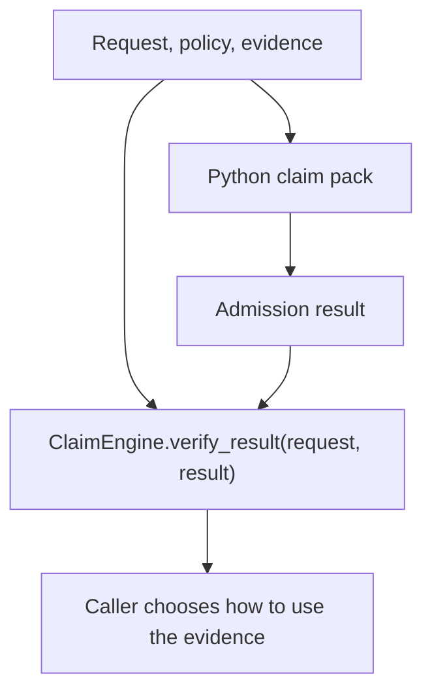

# Semadmit

**Deterministic, verifiable evidence-admission decisions for software agents and research systems.**

[](https://github.com/AbstractLogix/semadmit/actions/workflows/coverage.yml) [](LICENSE)  

Semadmit checks whether identified evidence may take part in one named operation under a declared policy. An evidence obligation is a policy requirement the supplied evidence must meet. Semadmit returns a result bound to the request, evidence identities, and decision so a caller can verify it before use.

## Admission outcomes

- **Admissible** — evidence may take part in the requested operation under the policy.
- **Inadmissible** — evidence fails a required check.
- **Indeterminate** — the available evidence cannot support a decision; the caller handles it separately.

In the Python claim pack, `verification_status` (`VALID`, `INVALID`, or `UNKNOWN`) describes how supplied observations verify a bounded claim. `admission_status` and the Core state describe the admission outcome. `ClaimEngine.verify_result(request, result)` separately checks that the result matches its request.

## Quickstart

Requires CPython 3.13. No package install, API key, or external service is needed. From a terminal, run these three commands:

```sh
git clone https://github.com/AbstractLogix/semadmit.git
cd semadmit
PYTHONPATH=clients/python python3 examples/claim_quickstart.py
```

Expected output:

```text
valid: verification=VALID admission=ADMISSIBLE core=admissible
invalid: verification=INVALID admission=INADMISSIBLE core=inadmissible
indeterminate: verification=UNKNOWN admission=REQUIRES_SEPARATE_TREATMENT core=indeterminate
tampered result verification accepted: False
```

The example checks synthetic observations for a declared finite input set. It does not run the example function or make a claim about real software.

## Python API

The complete request, including its evidence, is in [`examples/claim_quickstart.py`](examples/claim_quickstart.py). This uses that example's request helper:

```python
from examples.claim_quickstart import request as make_request
from semadmit import ClaimEngine

claim_request = make_request(
    "valid",
    [
        {"input": -1, "output": 1},
        {"input": 0, "output": 0},
        {"input": 1, "output": 1},
    ],
)
engine = ClaimEngine()
result = engine.evaluate(claim_request)
assert engine.verify_result(claim_request, result)
```

`verify_result` checks that the result matches the same request under Semadmit's deterministic evaluation. It does not authenticate evidence or establish that a claim is true.

## Python claim flow



## Common uses

- Check supplied execution evidence against a bounded claim and its declared input domain.
- Verify a structured decision before a consumer uses it.
- Enforce evidence requirements in an agent workflow and route indeterminate results for separate handling.

## What Semadmit does NOT do

- Authenticate who created evidence or prove that its source is trustworthy.
- Decide whether a claim is true. `VALID` means only that supplied compatible observations satisfy the declared finite-domain check.
- Infer independent corroboration. `selector-provenance/0.1` is experimental and grants no positive independence decision.
- Prove general correctness or tell a consumer what to believe.

## Scope and further reading

The Python `semadmit/claim/0.1` pack is supported on CPython 3.13. Claim-pack semantics are Python-only. Haskell supports selected Core semantics; it does not implement the claim pack. CI qualifies Linux x86_64. Other platforms and Haskell binary distribution are not qualified. The `selector-provenance/0.1` pack remains experimental.

- [Core and claim protocol specifications](specs/001-semantic-oracle-v0-1/spec.md) · [claim details](specs/002-structured-claim-admission/spec.md)
- [Research record](specs/001-semantic-oracle-v0-1/research.md) · [assurance and release limits](docs/release-assurance.md)
- [Consumer compatibility contract and pin](docs/bouleusis-compatibility.md) · [public-source readiness report](docs/public-source-readiness.md)
- [Contributing](CONTRIBUTING.md) · [Security reporting](SECURITY.md)

Semadmit source is licensed under [Apache-2.0](LICENSE). Adapted third-party material retains its own license; see [third-party notices](THIRD-PARTY-NOTICES.md).
